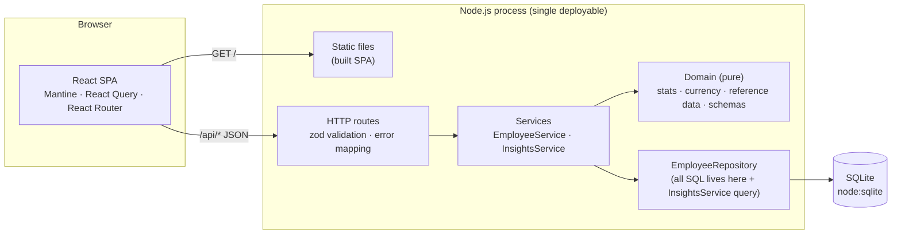
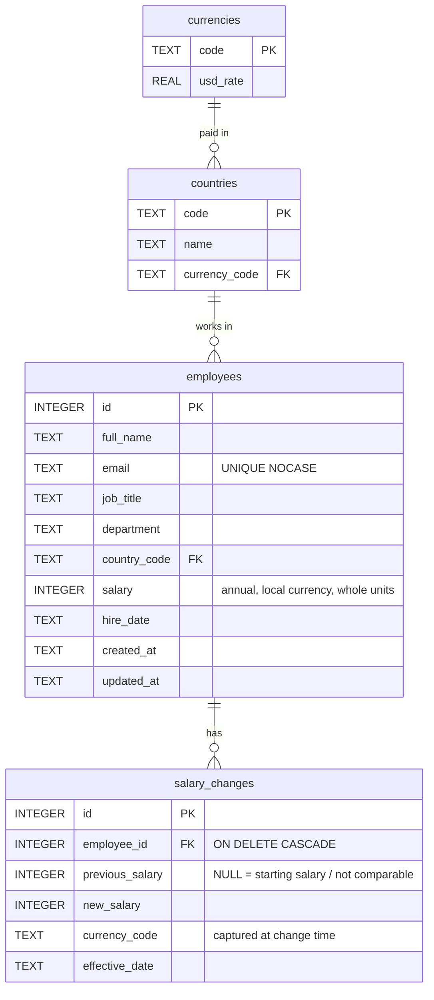

# Architecture

## Overview

One process serves both the API and the built UI, so there is one thing to deploy, no CORS, and no separate hosting for the frontend. In development, Vite serves the UI and proxies `/api` to the server.

## Layers (server)

| Layer | Folder | Responsibility | Tested by |
|---|---|---|---|
| Domain | `server/src/domain` | Pure functions & schemas: quantiles, histogram, FX conversion, input validation, reference data. No I/O. | Unit tests (`test/domain`) |
| Repository | `server/src/repositories` | SQL only. Whitelisted `ORDER BY`, parameterised queries, row → DTO mapping. | Through service tests (real in-memory SQLite) |
| Service | `server/src/services` | Business rules: salary history on change, email uniqueness → `ConflictError`, insights currency rule. Transactions. | Service tests (`test/services`) |
| HTTP | `server/src/http` | Parse/validate input with zod, call a service, map domain errors to status codes. No business logic. | Contract tests with supertest (`test/http`) |
| Seed | `server/src/seed` | Deterministic data generator (pure) + bulk insert. | Generator tests (`test/seed`) |

`createApp({ db, clock })` is the composition root; tests build an app per in-memory database with a fixed clock, so every test is isolated, fast (~1s for the whole suite) and deterministic.

## Data model

- **Currency is derived from country**, not stored on the employee, so it can never disagree with the country.
- `currencies` and `countries` are owned by code (`domain/reference.ts`, `domain/currency.ts`) and upserted on startup, so the rate table is versioned with the code.
- Indexes on `country_code`, `department`, `job_title`, `full_name` back the directory filters and default sort.

## API

| Method & path | Purpose |
|---|---|
| `GET /api/employees?search&country&department&jobTitle&page&pageSize&sort&order` | Paginated directory. `sort=salary` orders by USD equivalent. |
| `GET /api/employees/:id` | Employee + salary history (newest first) |
| `POST /api/employees` | Create (records starting salary) → `201` + `Location` |
| `PUT /api/employees/:id` | Update (records a salary change if salary/currency changed) |
| `DELETE /api/employees/:id` | Delete (history cascades) → `204` |
| `GET /api/insights/summary?country` | Headcount, payroll, median/quartiles/mean |
| `GET /api/insights/breakdown?groupBy=country\|department\|jobTitle&country` | Per-group stats |
| `GET /api/insights/distribution?country` | Histogram with "nice" salary bands |
| `GET /api/meta` | Countries, departments, known job titles, FX table version |
| `GET /api/health` | Liveness for the host's health check |

Errors are JSON `{ error, fields? }`: `400` validation (with per-field messages the form shows inline), `404`, `409` duplicate email, `500` (logged, generic message).

## Frontend

- **Server state** via React Query (caching, background refetch, `keepPreviousData` so paging doesn't flash). Every write invalidates lists, details, insights and meta.
- **URL is the state** for directory filters/sort/page, the open employee (`?employee=123`) and insights scope (`?country=IN&groupBy=jobTitle`) — views are shareable and the back button works.
- **Drill-down**: every row in an insights table links to the directory pre-filtered to the people behind that number, sorted by salary.
- **Insights page is lazy-loaded** so charting code isn't downloaded until it's needed.
